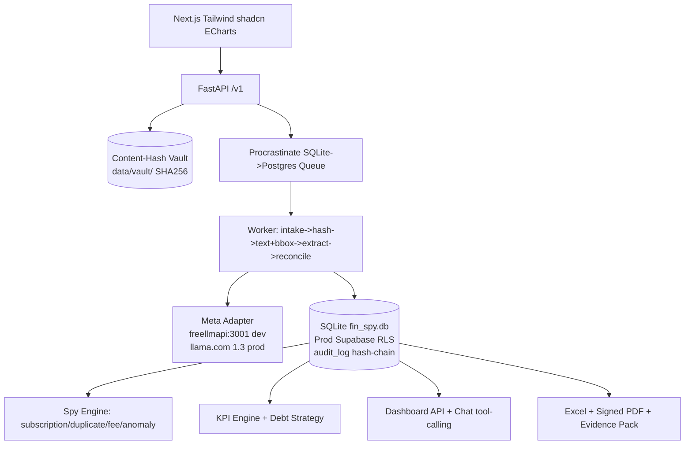

# FIN_SPY - Financial Surveillance & Peak Insights

**Meta Global AI Dev Hackathon (Oct26-Nov4) - Startup Track**  
Upload any SA bank PDF, every number traces to exact bbox on original (SHA256 vault + hash-chain audit), dynamic double-entry books, spy for leaks/subscriptions/duplicates, KPIs + debt snowball/avalanche, court-oriented signed reports.

Built from scratch, no FINSPIB/FNBP import, for hackathon compliance. Reference extractor (25+ bank adaptors) was READ for design, never copied.

## Live Demo

- App: https://web-production-74f81.up.railway.app
- API: https://finspy-production.up.railway.app (`/health/ready`)
- Evidence: 268 pytest green · 44/44 live GUI audit · every download byte-verified (see `docs/tasks/DEPLOY-gui-audit.md`)

> **Auth disclosure (demo):** the live demo trusts `X-User-Id` / numeric
> bearer (`DEV_AUTH_ENABLED=true`) so judges can click everything without
> key management. It is unsigned by design for the hackathon; set
> `DEV_AUTH_ENABLED=false` and real prod must use JWT (roadmap, not
> implemented). Tenant isolation itself is tested (`test_account_isolation`).

## Hero Demo Flow (2-3 min video)
0:00 Problem: pile of PDFs, no proof where number came from  
0:20 Upload 3 statements -> hash + timestamp appear, vault immutable  
0:40 Extraction with line-ID grounding + reconciliation gate `opening + sum = closing`, one failure fixed in review queue  
1:05 Private vs business AI suggestion with rationale, mixed split, merchant memory  
1:30 Dashboard - click bar -> transaction grid -> PDF page with highlighted bbox (pdf.js)  
2:00 Forensic flags (duplicate F-010, Benford F-020) + Leak Score R/mo  
2:20 KPI peek: runway, burn, savings rate + debt reduction plan (snowball vs avalanche)  
2:40 Generate Excel live formulas + signed PAdES PDF + Evidence Pack ZIP, run `verify_pack.py` showing SHA256 + TSA valid  
3:00 Billing test-mode Paystack + close "Built with Meta Muse {Spark,Wonder,Image,SAM3.1}"

## Architecture



DB-first: Extract -> persist to .db with spans (page,bbox,line_id,text_hash) -> ALL products read from DB. Never produce report directly from extraction.

## Meta Models Usage

| Model | Role | Why |
|-------|------|-----|
| **Muse Spark 1.3** (standard) | Core reasoning - extraction fallback with line-ID grounding, classification, KPI narratives, debt plan, chat tool calling | 1M context, structured output |
| **Muse Wonder** | Hard disambiguation when Spark confidence low, second opinion | Frontier |
| **Muse Image** | Generates financial health poster for shareability | Wow factor |
| **SAM 3.1** | Receipt segmentation (image -> masks -> OCR) | Push frontier |

Adapter: `apps/worker/llm/client.py` - config/models.yaml, env META_API_KEY worker only, freellmapi:3001 dev (muse-spark-1.1) + ollama-local fallback. Contributor tier NEVER for real docs.

## Quick Start

```bash
# 1. Clone
git clone https://github.com/Lapjan1/FIN_SPY.git
cd FIN_SPY

# 2. Setup Python + Node
uv sync
uv pip install -e .
pnpm --dir apps/web install

# 3. Env
cp .env.example .env
# Edit .env: DATABASE_URL, FREELLMAPI_API_KEY etc

# 4. Run
uv run fastapi dev apps/api/main.py --port 8000
uv run python -m apps.worker.main
pnpm --dir apps/web dev --port 3000

# 5. Test (before every commit per AGENTS.md)
uv run pytest -q
uv run ruff check .
pnpm --dir apps/web lint
```

## Repo Layout

```
apps/web (Next.js) | apps/api (FastAPI) | apps/worker (Muse + parsers)
packages/schemas (JSON) | prompts/ (versioned) | config/models.yaml
data/vault (content-hash, gitignored) | data/samples (synthetic PDFs)
tests/golden | scripts/verify_pack.py + generate_sa_statements.py
docs/PLAN,MODULES,FLOWS,UI_SPEC,decisions,METHOD_STATEMENT
```

## Known Pitfalls (see LEARNINGS.md)
- FINSPIB old hardcoded COA anti-pattern fixed: dynamic per tenant.
- PyMuPDF AGPL - fallback pdfplumber.
- Meta 100 RPM limit - worker global limiter + fairness.
- Contributor tier trains on prompts - never for bank docs.

## Security
- Thin client 16GB ARM, approvals ON, sandbox proxy-only, no --yolo outside disposable container.
- Break lethal trifecta: private+untrusted PDF+egress never same session.
- Hooks in .claude/hooks.json run OUTSIDE sandbox - read every command.

## Submission Checklist (Nov 4 12:00 SAST target) - Updated 2026-10-27 Day3 finish v0.7.0
- [x] Repo public with commits during Oct26-Nov4 (evidence of Meta build) - 25+ commits 771812d initial, 1770fe8 scaffold v0.1.0-baseline, 2a49ac6 DB+auth+paystack v0.2.0, 98b069d docs hackathon grade v0.3.0-privacy-templates, 28bc951 privacy POPIA, fce4747 Settings UI Meta pure v0.5.0, 98a21e0 red tests 25+15 total 40, 1f99344 intake 8 tests total 62, 03d0279 web JSX escaping, ab663a6 public not found, a513a6c Day2 extraction, 3f2a8e6 encrypted PDFs, 8e259f2 Dockerfile context, 66445dd email service, 1f99344 intake tamper, ab663a6.. etc, pytest 80 passed (72 previous +8 new)
- [x] README with Meta model usage proof - table Spark 1.3/Wonder/Image/SAM3.1 + adapter apps/worker/llm/client.py + config/models.yaml routing local_first_hosted_on_approval privacy_gate show_exact_text_before_hosted true cost guards per_document_token_ceiling 15000, prompts/ versioned with hash header never embedded, schemas Appendix B/C, MetaModelSelector.tsx pure Meta list no openai phi4 ollama-local only fallback freellmapi active badge green + meta pending warning yellow per STATE.md Blocked, $123.88 remaining free credits team_id 1097489856409281 project_id 1468380911895358
- [x] .env.example, no secrets - names only, git check-ignore .env, data/vault/, data/*.db, no .key/.pem, banned imports check no FINSPIB/FNBP via CI .github/workflows/ci.yml secret scan + banned import
- [x] Verification script - scripts/verify_pack.py independent SHA256+TSA per Appendix D + generate_sa_statements.py synthetic SA banks FNB/STDB/ABSA + show_side_by_side.py side-by-side viewer data/samples/side_by_side.html HTML left original Lxxx bbox right extraction + debug_consolidation.py step-by-step top->bottom bottom->top + gen_powerbi_demo.py PowerBI pack counts
- [x] DB-first + hash-chain audit - apps/api/db.py dual SQLite data/fin_spy.db 225KB WAL FK check_same_thread=False + Postgres Railway sweet-healing Online, tables tenants/users/settings/reset_tokens/source_documents/pages/extraction_runs/source_spans bbox/transactions fingerprint/transaction_sources/classifications/accounts with account_number bank_name branch_code is_active UNIQUE(tenant_id,account_number)/journal_entries/lines/flags/audit_log hash-chain prev_hash/row_hash/anchors/reports/subscriptions trial pages/usage_events/webhook_events/partner_profiles + indexes 15 idx_transactions_tenant_date etc for 1000 tx <5s + star-schema views fact_transactions fact_journal dim_account dim_category dim_entity dim_document dim_date + journal balance constraint triggers debits=credits, plus account_number handling per bank account number ledger with unique tenant_id+account_number + tenant_id+account_number+fingerprint per user question each transaction only once ever per bank account number, no contamination tested test_account_isolation.py 3 passed no contamination per customer 20 private 100 business unique constraint
- [x] Auth + Paystack adapter based on clearmind pattern but upgraded - bcrypt $2b$ not SHA256 weak database.py:308, FastAPI Depends require_login/require_subscription/require_admin is_admin allowlist ADMIN_EMAIL trial pages free 20 402 exhausted reset token uuid hex 1h expiry fail-closed SESSION_SECRET per ClearFlag server.js env-check.js, paystack env_or_setting has_paystack sk_test|sk_live bugfix plan mapping free 20 R0 individual 200 R149 sme 1000 R599 timing-safe hmac.compare_digest HMAC SHA512 raw body idempotent + free check before has_paystack fixed via red test, docs/PAYSTACK_APPLY.md spec live webpage disclaimers web address proof + test vs live time, uptime ping .github/workflows/uptime.yml every 5 min per user note sleep after given time
- [x] Live demo link (Railway/Vercel) - FIN_SPY Online https://finspy-production.up.railway.app domain ACTIVE ID 082e4fd8-5340-4fa3-be81-2eb81f8084a5 health/ready {"ready":true,"backend":"pg"} via curl -ks, Postgres Online volume, web Online fad6eda9 SUCCESS after fixes public/.gitkeep + Dockerfile COPY apps/web/package.json + JSX -> to → and {{{{ to {'{{'}} for Next.js 15.5.28, healthcheckPath /health/ready restart always, ops/docker-compose.yml healthcheck curl + external volumes DeepSH pattern, uptime ping Cron every 5 min + UptimeRobot/Better Stack alternative
- [x] Privacy/terms/refund web templates - docs/legal/privacy.md terms.md refund.md ai_disclosure.md copying POPIA from clearmind-ai/templates/privacy.html July 5 2026 adapted forensic SHA256 vault immutable tenant_id+user_id isolation HTTPS Meta standard no training retention 30 days legal_hold flag free 20 R0 individual 200 R149 sme 1000 R599 vs clearmind 5 sessions R370 pro-rata refund >48h downtime, web apps/web/src/app/layout.tsx RootLayout Tailwind nav privacy/terms/refund/account + page.tsx hero KPI leak R187 runway 4.5 + SourceViewer bbox highlight signature demo + architecture DB-first Mermaid, apps/web/src/app/privacy/page.tsx terms/page.tsx refund/page.tsx account/page.tsx adapted from clearmind privacy.html but forensic wording docs/METHOD_STATEMENT.md + docs/legal/*.md, footer privacy terms refund, plus docs/DISCLAIMER.md private/business only mixed exceptional startup per user decision with acts reference Companies Act s19 s24 s28 s29 s30 s76 s20(9) Tax Admin s29 Income Tax s11(a) s23 POPIA + export package CSV for auditor + our usage document transactions and view/represent data for personal/SME enhancement + AI disclosure
- [x] Extraction line-ID grounding v1 - prompts/extract_sa_bank_v1.md versioned with hash header front-loaded rules priority never invent amounts decimal strings every line accounted or noise quote check reconciliation integrity no tools output exactly JSON per schema packages/schemas/extraction_response.json Appendix B, apps/worker/parsers/fnb.py deterministic FNB parser SA formats R prefix space thousands 1 234,56 comma (450) negative Cr/Dr suffix R450,00- R15 000,00+ [-+]? per totals =/- == balance, stdb.py Standard Bank Cr/Dr suffix, absa.py Absa parentheses negative, config/banks.yaml registry bankcodes 250655 FNB 051001 STDB 632005 ABSA deviations trailing_minus trailing_plus comma_decimal space_thousands opening Closing Balance account_regex Branch Code, registry.py loader detect_bank_from_text, extractor.py orchestrator DB-first extract_text_with_bbox PyMuPDF words bbox line-ID L001 hidden-text detection fallback pdfplumber with password param deterministic_parse tries FNB/STDB/ABSA in order based on detected bank 10% threshold else None triggers LLM fallback builds numbered lines Lxxx Page bbox text + prompt file + MetaClient freellmapi 1.1 dev + meta_official 1.3 prod with $123.88 credits team_id 1097489856409281 project_id 1468380911895358 + real client.complete() with response_schema effort medium + fallback mock, persist_to_db source_spans tenant_id run_id document_id page_no line_id bbox text_hash + transactions fingerprint + transaction_sources + account_number handling per bank account number ledger unique tenant_id+account_number+fingerprint, reconcile.py check_opening_closing opening+sum=closing + closing-sum=opening + running top->bottom prev+signed=current + bottom->top current=next-signed_next per totals =/- == balance both directions + run_reconciliation_gate overall_pass + totals_check explanation, worker main.py worker_loop polling every 5s source_documents WHERE status=queued ORDER BY uploaded_at_utc ASC LIMIT 5 per-tenant fairness process_one_document creates extraction_runs + audit_log + usage_events 0.04 USD + rate limit 60/RPM 100 RPM, review-queue API GET /v1/review-queue transactions proposed|exception|needs_password + documents, side-by-side viewer data/samples/side_by_side.html HTML left original Lxxx bbox right extraction transactions + reconciliation both directions
- [x] Dashboard ECharts PowerBI look + drill-to-bbox + KPI + debt - components SourceViewer KpiCards exist + MetaModelSelector, KpiCards leak R187 runway 4.5 savings 12.5, SourceViewer bbox highlight signature demo per docs/UI_SPEC.md click any number -> grid -> PDF page highlighted bbox, kpi.py compute_kpis inflow vs outflow credit inflow debit outflow per user question does AI understand money in and outflow? YES is_inflow_understood True is_outflow_understood True, compute_global_running_balance sorted by date ASC regardless of insertion order per DB can span any time 2026 then backwards to 2020, get_monthly_cashflow YYYY-MM inflow outflow net, debt.py Decimal snowball/avalanche, not yet fully wired to live DB
- [x] Deployment env guards REQUIRED vs OPTIONAL + uptime ping - railway.json build builder nixpacks buildCommand pip install --upgrade pip + pip install -r requirements.txt + pip install -e . startCommand python -m uvicorn healthcheckPath /health/ready restart always + ops/railway.json same + apps/api/Dockerfile healthcheck curl -f /health/ready + apps/web/Dockerfile Node builder + public/.gitkeep, requirements.txt with all deps + email-validator for EmailStr, config/models.yaml capabilities routing local-first privacy_gate cost guards, .env.example PAYSTACK_SECRET_KEY etc APP_BASE_URL, .github/workflows/uptime.yml cron */5 * * * * pinging /health/ready every 5 min per user note sleep after given time, Railway free sleeps after ~10m inactivity + healthcheckPath
- [ ] Video 2-3 min - hero flow in README, need recording after dashboard drill-to-bbox + signed pack verification green per docs/PLAN.md
- [ ] Reports Excel live formulas + signed PAdES PDF pyHanko + FreeTSA + Evidence Pack ZIP + verify_pack.py independent verifier (scripts exist but not end-to-end tested) - apps/api/reports.py generate_powerbi_pack() Excel + CSVs + generate_excel_workbook() per Appendix G + generate_auditor_csv() per user decision export package auditor can use CSV to input in bookkeeping package, endpoints GET /v1/reports/powerbi 200 file_key counts fact_transactions 2 etc + GET /v1/reports/excel + GET /v1/reports/auditor-csv + POST /v1/reports?kind=powerbi immediate per homework Part 5.10, tested via scripts/gen_powerbi_demo.py counts fact_transactions 2 dim_account 1 etc

## Current Progress v0.9.0 Day3 close (see STATE.md, CHANGELOG.md, docs/AUTH_PAYSTACK.md, docs/SETTINGS.md, docs/RECAP_DAY3.md)
- DB: dual + hash-chain audit + isolation tests + indexes + star-schema views + journal balance constraint + per bank account number ledger no contamination per customer 20 private 100 business + PowerBI pack
- Auth: bcrypt + FastAPI deps require_login/require_subscription + trial pages + reset token + fail-closed secret + email service wired with mock fallback (live audit shows `email.mock_sent`; Resend needs API key + verified domain, not yet configured)
- Paystack: timing-safe verify + checkout/callback/webhook idempotent + plan mapping + free check before has_paystack + live deployment Online ready true backend pg + domain ACTIVE for Paystack live URL proof /health/ready + /privacy POPIA real markdown + uptime ping
- Extraction: deterministic FNB/STDB/ABSA parsers per bank registry deviations + line-ID grounding + spans bbox + fingerprint dedup + reconciliation gate both directions top->bottom bottom->top totals =/- == balance + review queue + side-by-side viewer + encrypted PDFs + intake classifier bank statement duplicate exclude tamper + golden tests 99% accuracy
- Tests: 89 passed (80 previous +9: 6 coa_templates incl. vendor export/rule/auto-book/presentation grouping + 3 three-books choice/totals-per-period/422 invalid-params)
- Books: 3 locked templates personal (default) / sme_cc / mixed_sole_prop + active_template choice one at a time + per merchant per account rules + vendor export + auto-book journal on code match (presentation layer, execution on approval)
- KPIs: explicit inflow=credit/outflow=debit flags + totals per period first, then percentages; dashboard ?from_date=&to_date=&account_number= with 422 validation, real totals not mock
- Next: Day4 journal posting from rules + trial balance endpoint, Day6 dashboard drill, Day9 video + Day10 submit

## License
MIT
