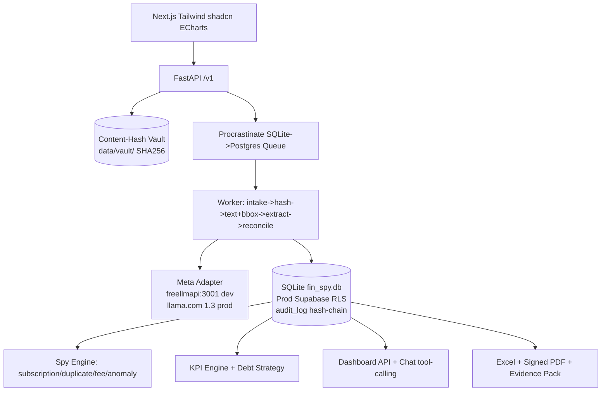

# FIN_SPY - Financial Surveillance & Peak Insights

**Meta Global AI Dev Hackathon (Oct26-Nov4) - Startup Track**  
Upload any SA bank PDF, every number traces to exact bbox on original (SHA256 vault + hash-chain audit), dynamic double-entry books, spy for leaks/subscriptions/duplicates, KPIs + debt snowball/avalanche, court-oriented signed reports.

Built from scratch, no FINSPIB/FNBP import, for hackathon compliance. Reference extractor (25+ bank adaptors) was READ for design, never copied.

## Hero Demo Flow (2-3 min video)
0:00 Problem: pile of PDFs, no proof where number came from  
0:20 Upload 3 statements -> hash + timestamp appear, vault immutable  
0:40 Extraction with line-ID grounding + reconciliation gate `opening + sum = closing`, one failure fixed in review queue  
1:05 Private vs business AI suggestion with rationale, mixed split, merchant memory  
1:30 Dashboard - click bar -> transaction grid -> PDF page with highlighted bbox (pdf.js)  
2:00 Forensic flags (duplicate F-010, Benford F-020) + Leak Score R/mo  
2:20 KPI peek: runway, burn, savings rate + debt reduction plan (snowball vs avalanche)  
2:40 Generate Excel live formulas + signed PAdES PDF + Evidence Pack ZIP, run `verify_pack.py` showing SHA256 + TSA valid  
3:00 Billing test-mode Paystack + close "Built with Meta Muse {Spark,Wonder,Image,SAM3.1}"

## Architecture



DB-first: Extract -> persist to .db with spans (page,bbox,line_id,text_hash) -> ALL products read from DB. Never produce report directly from extraction.

## Meta Models Usage

| Model | Role | Why |
|-------|------|-----|
| **Muse Spark 1.3** (standard) | Core reasoning - extraction fallback with line-ID grounding, classification, KPI narratives, debt plan, chat tool calling | 1M context, structured output |
| **Muse Wonder** | Hard disambiguation when Spark confidence low, second opinion | Frontier |
| **Muse Image** | Generates financial health poster for shareability | Wow factor |
| **SAM 3.1** | Receipt segmentation (image -> masks -> OCR) | Push frontier |

Adapter: `apps/worker/llm/client.py` - config/models.yaml, env META_API_KEY worker only, freellmapi:3001 dev (muse-spark-1.1) + ollama-local fallback. Contributor tier NEVER for real docs.

## Quick Start

```bash
# 1. Clone
git clone https://github.com/Lapjan1/FIN_SPY.git
cd FIN_SPY

# 2. Setup Python + Node
uv sync
uv pip install -e .
pnpm --dir apps/web install

# 3. Env
cp .env.example .env
# Edit .env: DATABASE_URL, FREELLMAPI_API_KEY etc

# 4. Run
uv run fastapi dev apps/api/main.py --port 8000
uv run python -m apps.worker.main
pnpm --dir apps/web dev --port 3000

# 5. Test (before every commit per AGENTS.md)
uv run pytest -q
uv run ruff check .
pnpm --dir apps/web lint
```

## Repo Layout

```
apps/web (Next.js) | apps/api (FastAPI) | apps/worker (Muse + parsers)
packages/schemas (JSON) | prompts/ (versioned) | config/models.yaml
data/vault (content-hash, gitignored) | data/samples (synthetic PDFs)
tests/golden | scripts/verify_pack.py + generate_sa_statements.py
docs/PLAN,MODULES,FLOWS,UI_SPEC,decisions,METHOD_STATEMENT
```

## Known Pitfalls (see LEARNINGS.md)
- FINSPIB old hardcoded COA anti-pattern fixed: dynamic per tenant.
- PyMuPDF AGPL - fallback pdfplumber.
- Meta 100 RPM limit - worker global limiter + fairness.
- Contributor tier trains on prompts - never for bank docs.

## Security
- Thin client 16GB ARM, approvals ON, sandbox proxy-only, no --yolo outside disposable container.
- Break lethal trifecta: private+untrusted PDF+egress never same session.
- Hooks in .claude/hooks.json run OUTSIDE sandbox - read every command.

## Submission Checklist (Nov 4 12:00 SAST target)
- [ ] Live demo link (Railway/Vercel)
- [ ] Video 2-3 min
- [ ] Repo public with commits during Oct26-Nov4 (evidence of Meta build)
- [ ] README with Meta model usage proof
- [ ] .env.example, no secrets
- [ ] Verification script passes hashes+TSA

## License
MIT
