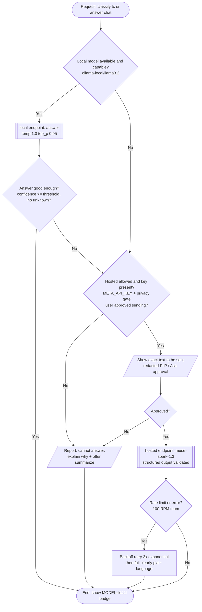

# FLOWS.md - Flowcharts (Mermaid, text-based, lives in git)

## Main Pipeline: Upload to Evidence (DB-first)

```mermaid
flowchart TD
  A([Start: Upload PDF/CSV/Image]) --> B[/API POST /v1/documents<br/>size/type check/]
  B --> C{Sanitize pass?<br/>no JS, no incremental, <50MB}
  C -- No --> D[/Return PdfAnomalyError/]
  C -- Yes --> E[[intake-vault: hash SHA256, store content-addressed<br/>key=sha256, never overwrite]]
  E --> F[[Append audit_log<br/>prev_hash|canonical_json -> row_hash SHA256]]
  F --> G[[Enqueue job Procrastinate<br/>idempotency key=doc sha256]]
  G --> H[[text-extract: PyMuPDF words+bbox+lineID<br/>detect hidden text]]
  H --> I{Usable text layer?}
  I -- No --> J[[OCR myPDF Tesseract copy<br/>original kept]]
  I -- Yes --> K[[Deterministic parsers<br/>FNB/STDB/ABSA regex/table]]
  J --> K
  K --> L{Reconciliation gate<br/>opening + signed rows = closing?<br/>running balance monotonic?}
  L -- Fail -> LLM --> M[[llm-client: Muse Spark 1.3<br/>line-ID grounding<br/>Lxxx + bbox must cite line_ids]]
  L -- Pass --> N[[Validate schema + quote exists + line IDs exist<br/>all lines accounted or noise]]
  M --> N
  N --> O[[Persist: extraction_runs<br/>model_id,prompt_hash,params,git commit,raw_output hash<br/>+ source_spans + transactions fingerprint<br/>+ transaction_sources]]
  O --> P[[ledger-core: post to journals<br/>debits=credits, entities, drawings]]
  P --> Q[[spy-leak + forensic-tests<br/>flags with evidence links]]
  Q --> R[[kpi-engine + debt-strategy<br/>runway burn savings]]
  R --> S[/Dashboard API ready<br/>Transaction grid + source viewer deep link/]
  S --> Z([End: peek ready, export ready])
```

DB-first rule: every arrow that produces data writes to .db before next step. Products never read raw extraction.

## Agent Loop (perceive-decide-act, step cap + approval gate) - Standard #1

```mermaid
flowchart TD
  A([Start: user task]) --> B[Build context: front-loaded rules + SYSTEM + tools + goal at START]
  B --> C[[llm-client: call model<br/>effort medium, temp low, schema-enforced]]
  C --> D{Model asked tool_calls?}
  D -- No --> J[/Show final answer/<br/>cites evidence tool output/]
  D -- Yes --> E{Tool needs approval?<br/>risk class writes-local|network|destructive}
  E -- Yes --> F[/Ask user: show exact text to be sent / command/]
  F --> G{Approved?}
  G -- No --> H[Return denied as tool result]
  G -- Yes --> I[[tools: run tool<br/>real output, never invent]]
  E -- No --> I
  I --> K[Append tool result to context<br/>truncate if huge + note truncated]
  H --> K
  K --> L{Step limit or budget reached?<br/>--max-model-steps 40 + cost cap}
  L -- Yes --> M[/Stop partial result/<br/>plain language why/]
  L -- No --> C
  J --> Z([End])
  M --> Z
```

## Local-First Model Router (privacy gate) - Standard #2



## Extraction Fallback Flow (Two-Pass Agreement)

```mermaid
flowchart TD
  A([Page with no deterministic parse]) --> B[[Build numbered lines<br/>L001..Lnnn | date | desc | amount | balance | bbox]]
  B --> C[[Cheap pass: freellmapi/muse-spark-1.1 low effort]]
  C --> D{Parses? reconciliation pass? quote exists?}
  D -- Yes --> G[/Persist as proposed/]
  D -- No --> E[[Strong pass: META_API_KEY muse-spark-1.3 medium-high<br/>same prompt, stricter schema]]
  E --> F{Agree or disagreement?}
  F -- Agree --> G
  F -- Disagree --> H[/Route to review queue<br/>exception noted/]
```

## Evidence Pack Verification (Independent Verifier)

```mermaid
flowchart TD
  A([Start: user has evidence-pack.zip]) --> B[Unzip to temp]
  B --> C[Read manifest.json<br/>files[] with sha256, role]
  C --> D[For each file, recompute SHA256<br/>compare to manifest]
  D --> E{All match?}
  E -- No --> F[/Fail: tampered file list/]
  E -- Yes --> G[Recompute manifest SHA256<br/>compare to manifest.sha256 + printed in PDF footer]
  G --> H{Match?}
  H -- No --> I[/Fail: manifest tampered/]
  H -- Yes --> J[Verify RFC3161 .tsr tokens<br/>openssl ts -verify with TSA CA]
  J --> K{TSA valid?}
  K -- No --> L[/Fail: timestamp invalid/]
  K -- Yes --> M[Open PDF signature panel<br/>pyHanko PAdES]
  M --> Z([Pass: court-ready chain verified])
  F --> Z
  I --> Z
  L --> Z
```
