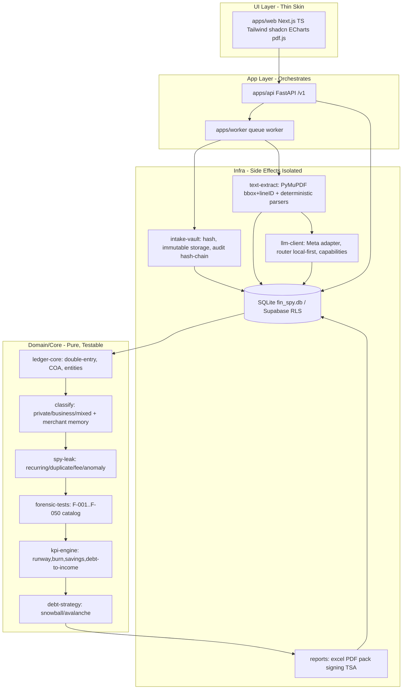

# MODULES.md - Module Cards + Dependency Diagram

## Dependency Diagram (one way, UI top, core below, infra bottom, no cycles)

## Module Cards (one sentence purpose, no "and", high cohesion)

**Name:** intake-vault
Purpose: Hash PDFs SHA256, store content-addressed immutable, hash-chain audit_log, TSA anchor.
Public API: `store_document(bytes,filename,actor) -> {sha256,storage_key,doc_id,audit_id}`, `get_document(sha256)`, `anchor_daily()`
Depends on: config, models
Used by: api, worker
Errors: raises VaultError(size/type/hash mismatch), `HashMismatch`
Tests: `tests/test_vault.py` - re-download hash matches, immutability deny overwrite
Owner: hacker seat

**Name:** text-extract
Purpose: Yield words/lines with bbox per page, numbered Lxxx, table detection.
Public API: `extract_pages(pdf_path) -> list[Page{no,width,height,lines:[{line_id,bbox,text,text_hash}]}]`, `detect_hidden_text(words) -> flags`
Depends on: vault, config
Used by: worker, llm-client
Errors: `PdfAnomalyError` (incremental updates, JS, producer mismatch), `HiddenTextFlag`
Tests: `tests/test_extract.py` synthetic 15 PDFs, page coverage check
Owner: research engineer

**Name:** llm-client
Purpose: One place for Meta Model API routing, capabilities, effort mapping, privacy gate.
Public API: `client.complete(messages,tools,schema,effort) -> ModelResult(content,tool_calls,usage)`, `Capabilities.max_context,supports_images,effort_levels`, `router_local_first(text) -> decision`
Depends on: config/models.yaml, prompts/
Used by: worker parsers, classify, debt, chat
Errors: `RateLimitError`, `ModelNotLoaded`, `PrivacyGateDenied`, `MalformedOutput`
Tests: `tests/fakes/FakeModelClient` returns scripted results + malformed, schema validation
Owner: AI research engineer

**Name:** ledger-core
Purpose: Dynamic double-entry ledger, generic SA COA seed, per-tenant learning, balanced journal enforcement.
Public API: `post_transaction(tx,classification) -> JournalEntry{lines debits=credits}`, `trial_balance(entity_id,date) -> {debits,credits,zero}`, `seed_coa(tenant_id) -> accounts`
Depends on: db, models
Used by: classify, api
Errors: `UnbalancedEntry`, `UnknownAccount`
Tests: `tests/test_ledger.py` - sum debits = credits per entry, trial sums zero
Owner: AI forensic scientist

**Name:** classify
Purpose: Decide private/business/mixed with % + category + rationale, source rule/ai/human, revision chain.
Public API: `suggest_classification(tx,tenant_rules, merchant_memory) -> {nature,business_pct,category,rationale,source,confidence}`, `decide(tx_id,nature,actor,reason) -> revision`
Depends on: ledger-core, llm-client
Used by: worker, api
Errors: `UnknownClassification`
Tests: `tests/test_classify.py` mixed split example business 60% private 40%
Owner: AI engineer

**Name:** spy-leak
Purpose: Find money leaks from DB, not from extraction.
Public API: `detect_recurring(tenant_id) -> [Subscription{merchant,amount,cadence,leak_per_mo}]`, `detect_duplicate(fingerprint)`, `detect_fee()`, `detect_anomaly_iqr()`
Depends on: db, ledger-core
Used by: worker, api dashboard
Errors: none, returns flags
Tests: `tests/test_spy.py` injected 2 duplicate subs, fee spike, anomaly
Owner: hacker seat + AI engineer

**Name:** forensic-tests
Purpose: Deterministic forensic analytics catalog F-001..F-050, each flag with evidence links.
Public API: `run_tests(tenant_id,window) -> [Flag{test_id,params,severity,result,code_version}]`, list per Part 5.9
Depends on: db
Used by: api, reports
Errors: none
Tests: `tests/test_forensic.py` duplicates, Benford with sample-size warning, round amounts
Owner: forensic scientist

**Name:** kpi-engine
Purpose: Compute peek KPIs from confirmed ledger.
Public API: `compute_kpis(tenant_id,period) -> {runway_months,burn_rate,savings_rate,debt_to_income,private_vs_business_ratio,top_vendors,subscription_creep}`
Depends on: db, ledger-core, spy-leak
Used by: api dashboard
Errors: `InsufficientData`
Tests: `tests/test_kpi.py` known dataset
Owner: AI engineer

**Name:** debt-strategy
Purpose: Generate debt snowball vs avalanche plans tailored to cashflow, SA context.
Public API: `plan_debts(debts[{creditor,balance,apr,min}],cashflow,method) -> {order,months,interest_saved,total_paid,narrative}`, `simulate_what_if(extra_payment)`
Depends on: kpi-engine, llm-client for narrative
Used by: api
Errors: `InvalidDebtInput`
Tests: `tests/test_debt.py` snowball vs avalanche order, Decimal maths exact
Owner: AI engineer + product owner

**Name:** reports
Purpose: Render Excel workbook live formulas, signed PDF, Evidence Pack ZIP manifest+hashes+tsr.
Public API: `render_excel(tenant_id,period) -> {file_key,sha256}`, `render_pdf(...)->{file_key,sha256,signature_info,tsa_token}`, `render_pack(report_id)->{zip_key,manifest}`
Depends on: db, vault, ledger-core, forensic-tests
Used by: api, worker
Errors: `ReportRenderError`
Tests: `tests/test_report.py` independent verifier re-hashes pack
Owner: forensic scientist

**Name:** dashboard web
Purpose: PowerBI-look UI thin skin that calls app layer only, never contains logic.
Public API: screens: Landing, Upload/Inbox, Review Queue, Transactions+Source Viewer, Dashboard, Reports/Billing
Depends on: api client generated from OpenAPI
Used by: browser
Errors: shows plain language error + logs details
Tests: `apps/web` smoke, screenshot review loop per UI_SPEC
Owner: product + hacker (XSS sanitize)
