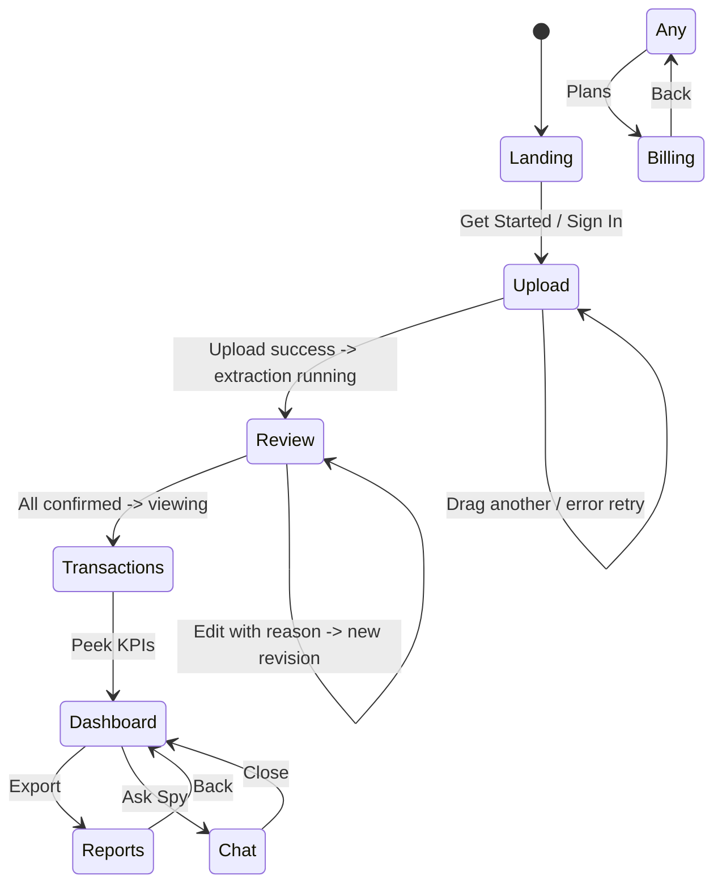

# UI_SPEC.md - Screens, Wireframes, Control->Function Map, States

## Screen Flow (State Diagram)

## Design Tokens (PowerBI dark/light look)

- Palette: dark #0f172a bg, #1e293b card, accent #38bdf8 (blue), leak #f43f5e (rose), success #22c55e, warning #eab308. Light: #f8fafc bg.
- Fonts: Inter + JetBrains Mono for numbers.
- One primary action per screen, quiet secondary, distinct destructive never next to primary.
- Never color alone - icon + text.

## Wireframes (ASCII boxes before color)

### Landing
+----------------------------------------------------------+
| FIN_SPY logo | Pricing | Docs | [Sign In] [Start Free]       |
| Your money has a stalker. Find it.                       |
| Upload any SA bank PDF -> every number traces to          |
| exact bbox, spy for leaks, KPI peek + debt kill plan.    |
| [Upload PDF] [See Demo with synthetic FNB]               |
| KPI tiles: Leak R/mo, Runway, Savings Rate, Top vendor   |
| Built with Meta Muse Spark/Wonder/Image/SAM 3.1          |
+----------------------------------------------------------+

### Upload / Inbox
+----------------------------------------------------------+
| [Drag PDF/CSV/Image here] or [Browse]                    |
| Recent docs: doc1.pdf SHA256:a1b2... Pages:8 Status:confirmed|
| Uploading: progress [====   ] Hashing...                 |
| Empty: "No docs yet - upload first statement"            |
| Loading: "Extracting L001..L120 + bboxes"                |
| Error: "Reconciliation failed: opening 12340 + sum -450 != closing 11890 - check page 3" |
+----------------------------------------------------------+

### Review Queue
+----------------------------------------------------------+
| Filters: status=proposed|exception, entity, date         |
| Transaction grid TanStack virtualized: date | desc | amount | balance | doc page line_ids | fingerprint |
| Row click -> split right panel: pdf.js page with highlight overlay (bbox yellow) |
| Edit: field, old->new, reason required, actor + at_utc -> new revision append-only |
| Exception noted checkbox for court-report exclusion      |
+----------------------------------------------------------+

### Transactions + Source Viewer (signature demo)
+----------------------------------------------------------+
| [Left: Grid] Date | Desc raw | Amount minor (Decimal) | Direction | Balance_after | Classif nature | Category |
| [Right: PDF viewer] Page image + word boxes, highlighted lines L012,L013 |
| Deep link: /transactions/{id}?doc=sha256&page=3&lines=L012,L013 |
| Footer: doc SHA256 prefix, extraction_run model_id, prompt hash |
+----------------------------------------------------------+

### Dashboard (Wow Day per homework Part 8 Day6)
+----------------------------------------------------------+
| Slicers: Entity [All|Personal|Business], Date range, Nature, Category, Account |
| KPI cards: Leak R/mo (trend delta), Runway months, Burn rate, Savings rate, Debt-to-income |
| Charts: Cashflow waterfall open->close, Category treemap, Calendar heatmap spend, Private vs Business split, Subscription radar table (merchant, amount, cadence, leak/mo), Anomaly markers |
| Cross-filter: click treemap category -> grid filtered -> PDF highlight |
| Drill: click any number -> grid -> PDF page |
| Debt widget: snowball vs avalanche toggle, payoff timeline bar, interest saved |
+----------------------------------------------------------+

### Reports / Evidence Pack
+----------------------------------------------------------+
| Generate: [Excel Workbook] [Signed PDF] [Evidence Pack ZIP] [PowerBI pack] |
| Excel sheets: Cover, Summary, Transactions Table, Journal, Trial_Balance live SUMIFS, Private_vs_Business, Flags, Source_Register, Method_Notes, Dictionary |
| PDF preview with footer report_id page x/y hash prefix, signature panel |
| Manifest verification: [Run verify_pack.py] -> hashes valid, TSA valid |
| AI disclosure: "Method: PyMuPDF + Muse Spark 1.3 line-ID grounded, reconciliation gate, human review, Date: ..." |
+----------------------------------------------------------+

### Chat Spy
+----------------------------------------------------------+
| Q: Where did my money go? |
| A: Tool calls: search_transactions -> results, citations: doc page lines, Leak: R187/mo Woolworths duplicate |
| Streaming answer compact status Thinking... step 3/20, reasoning collapsed, final answer main |
| Model badge: local vs hosted, token count, cost estimate |
| Approval dialogs: "Allow Send FrellmAPI?" shows exact text |
+----------------------------------------------------------+

### Billing
+----------------------------------------------------------+
| Plans: Free 20 pages/mo, Individual R149/200p, SME R599/1000p 2 entities, Practice custom |
| Usage meters: pages, tokens, exports, est_cost_usd |
| Paystack test checkout: initialize transaction server-side, webhook x-paystack-signature HMAC SHA512 idempotent |
| Grace 7 days read-only on payment_failed, email Resend free tier |
+----------------------------------------------------------+

## Control -> Function Map

| Screen | Control | Calls | Success | Error |
|--------|---------|-------|---------|-------|
| Upload | Drop PDF | `api.upload_document(file)` -> `worker.enqueue` | Show doc row SHA256, status queued | PdfAnomalyError dialog plain language |
| Review | Accept btn | `api.patch_transaction(id, status=confirmed, reason)` | Row green, audit_log append | Revision conflict |
| Transactions | Row click | `api.get_transaction_sources(id)` -> bbox | Right pdf highlight | Source missing -> flag exception |
| Dashboard | Category treemap click | `api.get_dashboard_summary?category=Groceries` | Grid filter + charts cross-filter | Empty state |
| Debt | Snowball toggle | `api.post_debt_plan(debts, method=snowball)` uses Decimal | Timeline + narrative from llm-client | Invalid input |
| Chat | Send | `api.chat(messages, tools)` tool calling search_transactions flag_explain | Streaming + citations | Rate limit -> backoff message |
| Reports | Generate Excel | `api.post_report(kind=excel)` idempotent key | Download link + SHA256 | ReportRenderError log details |

A control with no function = core missing capability -> add to MODULES.md first.

## Screen States (design, not just happy)

- Empty: first time, no docs, CTA Upload + demo data mode toggle
- Loading: progress bar + cancel flag, worker progress callback via queue
- Success: data
- Partial: some pages failed reconciliation, review needed banner
- Error: plain language what + how to fix, no stack trace, log file path + "Copy diagnostic"
- Disabled: why disabled (e.g., "Free plan 20 pages/mo reached, upgrade")

## Heuristics Checklist (Nielsen 10 + Shneiderman 8 + Accessibility)

- Visibility of system status: progress + audit_log head hash + model badge
- Match real world: SA Rands, "Drawings" not jargon, dates Africa/Johannesburg
- User control: Undo edit (new revision, not overwrite), Cancel queue job, Clear filters
- Consistency: same word for same thing (private/business/mixed/unknown everywhere)
- Error prevention: disable impossible actions, dropdowns not free text for category, confirm overwrite
- Recognition over recall: show merchant memory suggestions, recent classifications
- Flexibility: keyboard shortcuts (t=transactions, d=dashboard), sensible defaults
- Aesthetic minimal: one primary per screen, spacing grid, 1-2 fonts, named theme values not hardcoded widget
- Error recovery: plain language, suggestion, copy log
- Help: tooltips per forensic flag, method statement link
- Accessibility: Tab order, focus indicator, contrast 4.5:1 checked, screen reader names, no hover-only, no color-only meaning (leak = rose + icon + text)

## /taste Anti-Slop
Avoid purple gradient centered hero 3-card grid. Explicit style above wins per docs/UI_SPEC.md.

## Screenshot Review Loop (image-capable model can review)
Capture per screen state (empty,loading,success,error) -> feed to Muse Spark Wonder with wireframe + heuristics checklist -> numbered defects list what/where/rules/fix, must say "cannot tell" if image insufficient -> fix -> recapture. Human final call.
